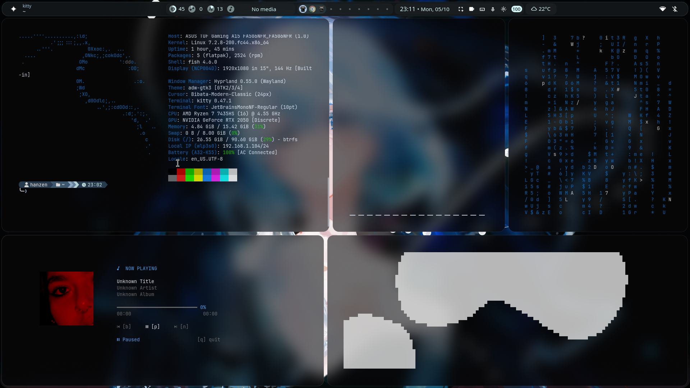

# Hyprland Dotfiles

My personal Hyprland configuration for Fedora Linux.

A dark, minimal desktop setup focused on a clean workflow, useful shortcuts, and a consistent terminal environment.

> ⚠️ **Personal configuration**
>
> This repository is primarily my personal dotfiles. Some configurations may depend on software, fonts, themes, or other packages installed on my system.
>
> Review the files before using them on your own setup.

## Preview



## What's Included

* Hyprland
* Waybar
* Kitty
* Custom keybindings
* Window rules
* Appearance & animations
* Terminal configuration
* Custom scripts
* Other desktop configuration files

## Structure

```text
hyprland-dotfiles/
├── hypr/
│   ├── hyprland.conf
│   ├── general.conf
│   ├── rules.conf
│   └── ...
├── README.md
└── ...
```

## Requirements

This configuration is intended for:

* Fedora Linux
* Hyprland
* Wayland
* Fish shell
* Kitty
* Waybar

Some additional packages may be required depending on the configuration you're using.

## Installation

### 1. Backup your current configuration

Before installing, make a backup:

```bash
mv ~/.config/hypr ~/.config/hypr.backup
```

### 2. Clone the repository

```bash
git clone https://github.com/moonelliaven/hyprland-dotfiles
git ~/Coding/hyprland-dotfiles
```

### 3. Create the symlink

```bash
ln -s ~/Coding/hyprland-dotfiles/hypr ~/.config/hypr
```

Your configuration will now be loaded from the Git repository.

##  Updating

If you already have this configuration installed:

```bash
cd ~/Coding/hyprland-dotfiles
git pull
```

Because `~/.config/hypr` is a symlink to the repository, the updated configuration will be available immediately.

## Customization

Feel free to modify the configuration to fit your own setup.

Some things you may want to change:

* Monitor resolution and layout
* Keybindings
* Wallpaper paths
* Application paths
* Fonts
* Waybar modules
* Terminal settings
* Scripts

## Important

Do **not** blindly copy configuration files from this repository into your system.

Check paths and dependencies first, especially:

```text
~/.config/
~/Pictures/
~/Downloads/
~/.local/bin/
```

Some paths or commands may be specific to my system.

## 🔐 Security

Never add passwords, API keys, tokens, private SSH keys, or other sensitive information to this repository.

## 📄 License

This repository is provided for personal use and reference.

Feel free to use, modify, and adapt the configuration for your own setup.
